<div align="center">

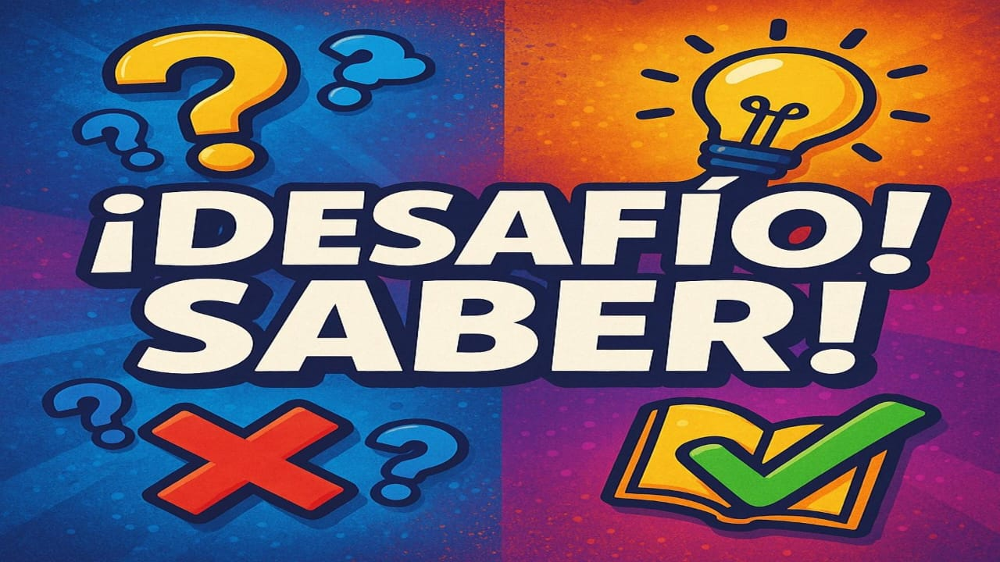

# DesafíoSaber

Juego de trivia de escritorio con **panel de administración web** y **sincronización en tiempo real**.
Ruleta de categorías, 3 modos de juego, 760 preguntas, ranking y logros.

[](https://github.com/vecs0/DesafioSaber/releases/latest)


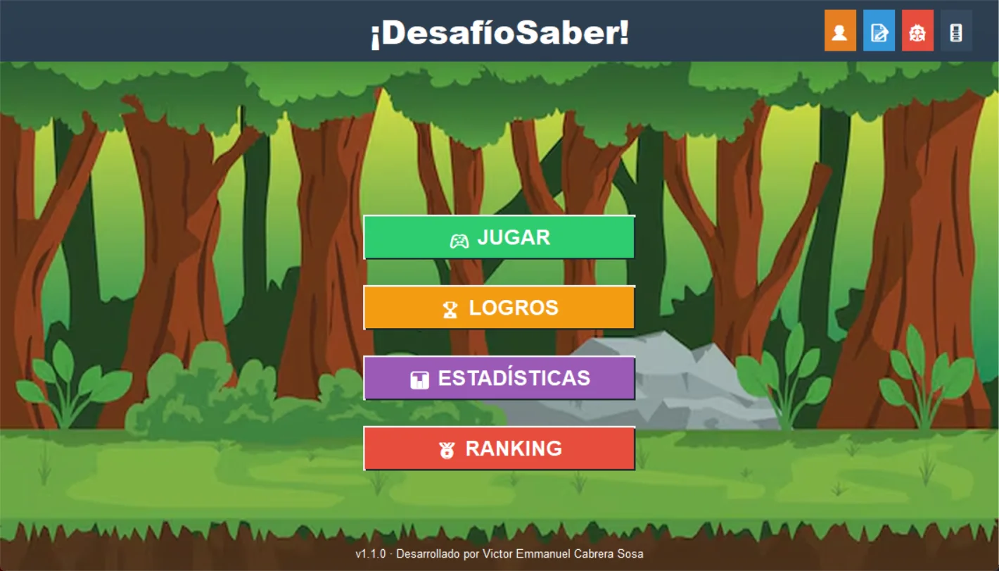

</div>

---

##  Descarga y demo

**[Descargar la última versión para Windows](https://github.com/vecs0/DesafioSaber/releases/latest)**

1. Descargá `DesafioSaber-v1.1.0-windows.zip` desde **Releases**.
2. Descomprimí la carpeta completa.
3. Ejecutá `DesafioSaber.exe`. No hace falta instalar Python.

> Windows puede mostrar el aviso "Windows protegió su PC" porque el ejecutable no está firmado. Elegí **Más información → Ejecutar de todas formas**.

El ejecutable incluye el juego completo. El panel de administración web se ejecuta desde el código fuente: ver [Correr en local](#-correr-en-local).

##  Funcionalidades

**Juego de escritorio**
- **3 modos de juego**:
  - **Clásico**: 15 preguntas, 20 s cada una.
  - **Contrarreloj**: 60 s totales y preguntas ilimitadas.
  - **Duelo**: 2 jugadores por turnos, con penalización por error.
- **6 categorías**: Historia, Ciencia, Geografía, Arte, Deportes y Entretenimiento, con 760 preguntas en 3 niveles de dificultad.
- **Ruleta animada** para elegir categoría, con música y efectos de sonido.
- **Puntuación dinámica** según el tiempo de respuesta, con resultados detallados.
- **Ranking global** filtrable por modo y categoría.
- **Registro de jugadores**, logros desbloqueables y estadísticas personales.

**Panel de administración web**
- **Dashboard** con métricas de preguntas, jugadores y partidas.
- **CRUD** de preguntas, categorías, modos de juego y jugadores.
- **Editor visual** de colores por categoría y estilos de botones.
- **Gestión de recursos** (imágenes y sonidos) y reportes de error.
- **Sincronización en tiempo real**: los cambios del panel llegan al juego al instante por WebSocket.

##  Capturas

### Juego de escritorio

| Modos de juego | Pregunta |
|---|---|
| 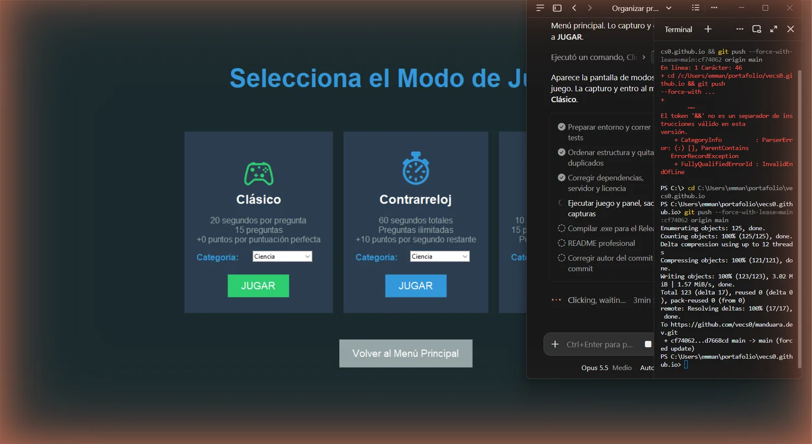 | 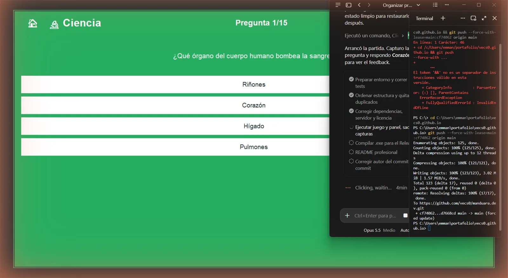 |
| **Resultados** | **Ranking global** |
| 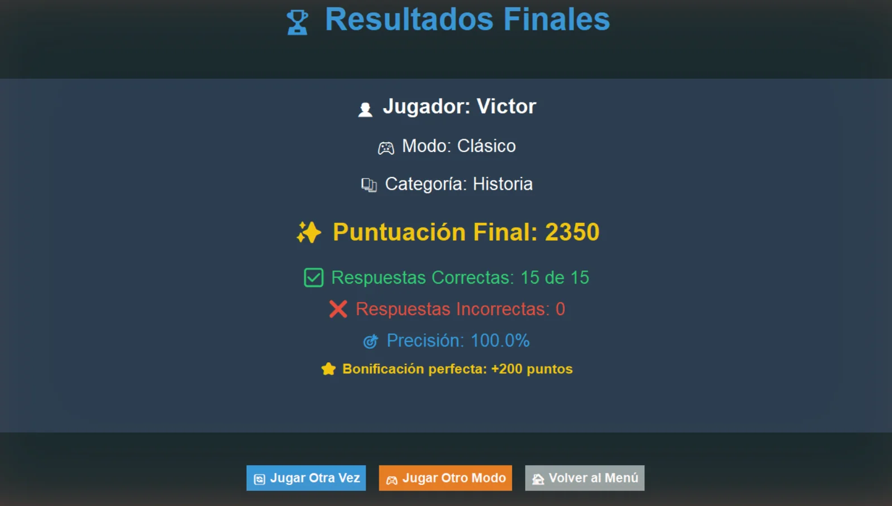 | 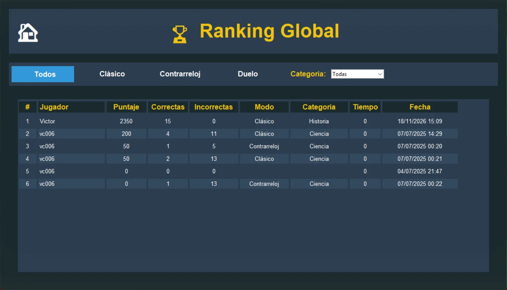 |

### Panel de administración

| Inicio de sesión | Dashboard |
|---|---|
| 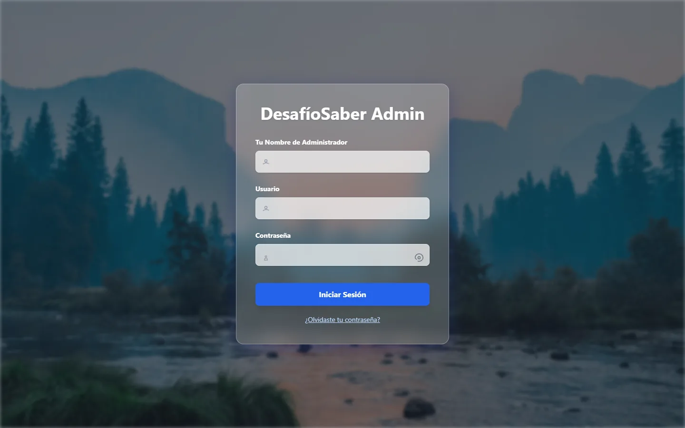 | 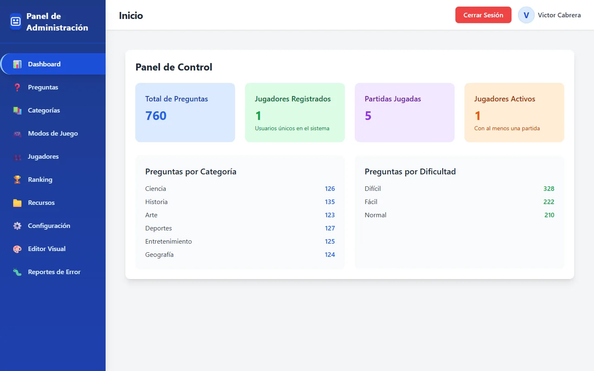 |
| **Gestión de preguntas** | **Editor visual** |
| 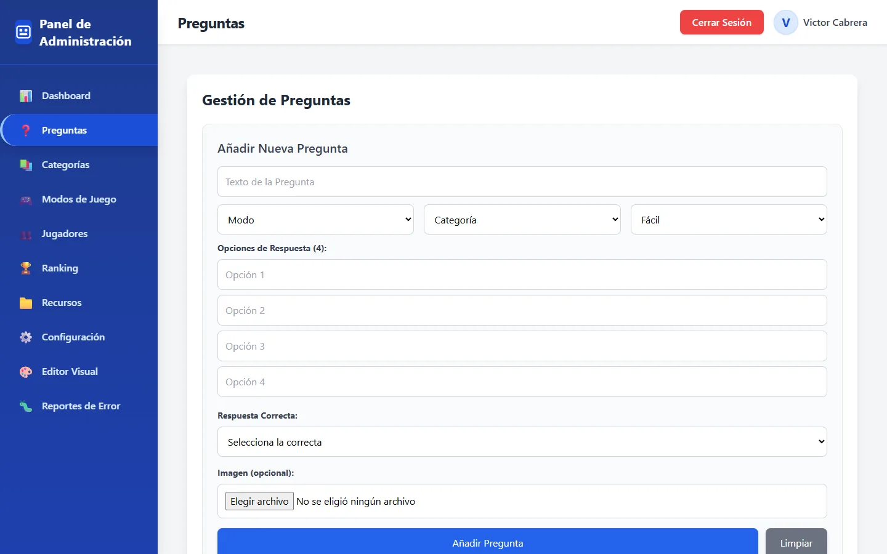 | 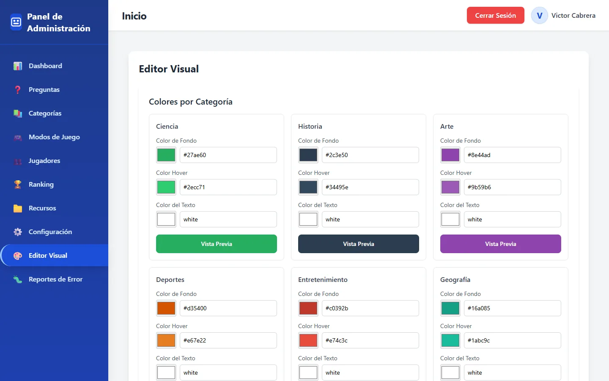 |
| **Categorías** | **Ranking** |
| 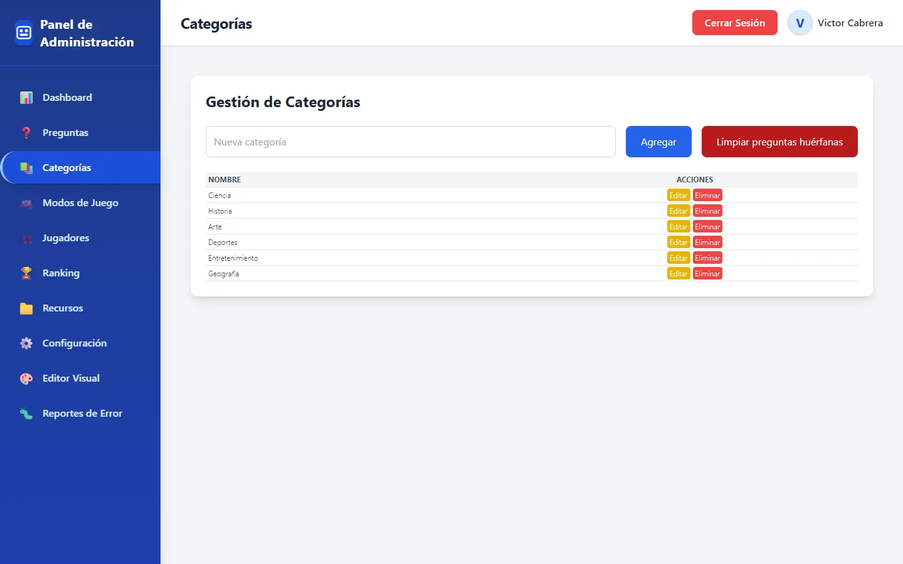 | 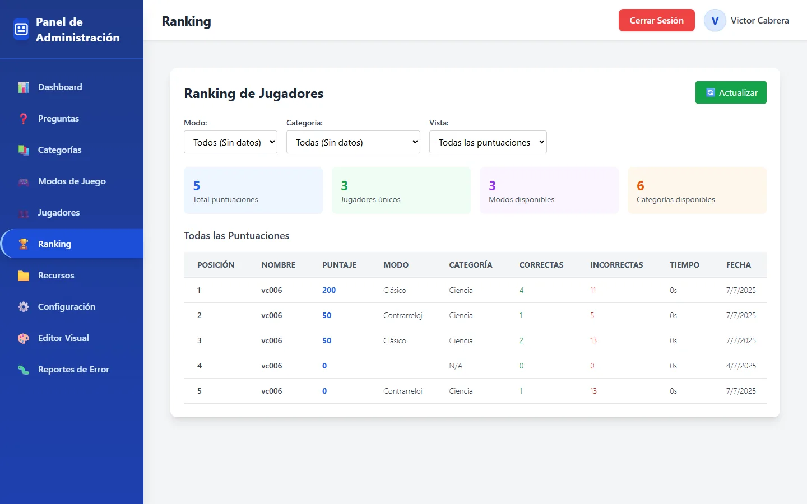 |

##  Arquitectura

```
┌────────────────────────┐   HTTP / REST    ┌─────────────────────────┐   HTTP + WebSocket   ┌──────────────────────┐
│  Juego de escritorio   │ ◄──────────────► │   Backend Flask         │ ◄──────────────────► │  Panel de admin      │
│  Python · Tkinter      │   WebSocket      │   API REST + Socket.IO  │                      │  React · Tailwind    │
│  Pygame (audio)        │ ◄─────────────── │   puerto 5000           │                      │  puerto 3000         │
└───────────┬────────────┘   (cambios)      └────────────┬────────────┘                      └──────────────────────┘
            │                                            │
            └──────────────►  data/*.json  ◄─────────────┘
                     (preguntas, usuarios, ranking, logros, configuración)
```

- El **juego** funciona solo, leyendo los JSON de `data/`. Si el backend está activo, además sincroniza estadísticas y recibe cambios al instante.
- El **backend** expone 47 endpoints REST y emite eventos por Socket.IO cada vez que cambia un dato.
- El **panel** consume la API y se actualiza en vivo al recibir esos eventos.

##  Tecnologías

| Capa | Tecnologías |
|---|---|
| **Juego** | Python 3.10+, Tkinter, Pygame (audio), Pillow |
| **Backend** | Flask, Flask-SocketIO, Flask-CORS |
| **Panel web** | React 18, Tailwind CSS, Chart.js, Socket.IO Client |
| **Datos** | Archivos JSON con backups automáticos |
| **Distribución** | PyInstaller (ejecutable de Windows) y GitHub Releases |
| **Pruebas** | pytest |

##  Estructura

```
DesafioSaber/
├── game/                  # Juego de escritorio (Tkinter)
│   ├── main.py            # Punto de entrada y pantallas del juego
│   ├── paths.py           # Rutas del proyecto (código fuente y .exe)
│   ├── wheel_animation.py # Ruleta de categorías
│   ├── achievements.py    # Sistema de logros
│   ├── user_registration.py
│   ├── api_client.py      # Cliente de la API
│   └── cloud_sync.py      # Sincronización con el backend
├── web_admin/             # Panel de administración
│   ├── server.py          # Backend Flask + Socket.IO
│   └── src/components/    # Componentes React
├── data/                  # Datos del juego en JSON
├── assets/                # Imágenes y sonidos
├── scripts/               # Iniciar, instalar y compilar
├── tools/                 # Utilidades de mantenimiento de datos
├── tests/                 # Pruebas con pytest
└── docs/                  # Manuales, documentación técnica y capturas
```

##  Correr en local

**Requisitos:** Python 3.10+ y Node.js 18+.

```bash
git clone https://github.com/vecs0/DesafioSaber.git
cd DesafioSaber
python -m venv venv
venv\Scripts\activate          # Linux/macOS: source venv/bin/activate
pip install -r requirements.txt
```

| Qué iniciar | Comando |
|---|---|
| Todo (backend + panel + juego) | `python scripts/start_all.py` |
| Solo el juego | `python game/main.py` |
| Solo el backend | `python scripts/start_backend.py` |
| Solo el panel web | `python scripts/start_frontend.py` |

El panel queda en http://localhost:3000 y el backend en http://localhost:5000. En Windows también podés usar `scripts\install_windows.bat` para instalar todo de una vez.

**Credenciales de demo del panel:** usuario `admin`, contraseña `admin123`. Son datos ficticios incluidos en `data/admins.json`.

### Compilar el ejecutable

```bash
pip install -r requirements-dev.txt
python scripts/build_exe.py
```

Genera `release/DesafioSaber-v<versión>-windows.zip`, listo para subir a un Release.

##  Pruebas

```bash
pip install -r requirements-dev.txt
python -m pytest tests
```

Hay 40 pruebas: flujos de preguntas, categorías, modos de juego, usuarios, puntuación, logros y sincronización. Algunas pruebas de integración necesitan el backend corriendo en el puerto 5000.

##  Documentación

| Documento | Contenido |
|---|---|
| [Manual de usuario](docs/manual-usuario.md) | Cómo jugar y usar el panel |
| [Recuperar el acceso de admin](docs/recuperacion-admin.md) | Restablecer la contraseña del administrador |
| [Documentación técnica](docs/tecnico/) | Arquitectura, puntuación, logros, usuarios, estilos y rendimiento |
| [Historial de desarrollo](docs/historial/) | Correcciones, checklists y notas de versiones anteriores |

##  Notas de seguridad

DesafíoSaber es un **proyecto local y educativo**: el backend escucha solo en `127.0.0.1` y no está pensado para publicarse en internet.

- El inicio de sesión del panel se verifica en el servidor, y la API nunca envía contraseñas al navegador.
- El modo debug y el acceso desde la red local se activan solo si se pide, con `DESAFIO_DEBUG=1` y `DESAFIO_HOST=0.0.0.0`.
- Para usarlo en producción faltaría guardar las contraseñas con hash y sal, usar sesiones con tokens y proteger todos los endpoints.

##  Versiones

| Versión | Fecha | Cambios |
|---|---|---|
| **v1.1.0** | 2026 | Reorganización del repositorio, rutas que funcionan desde cualquier carpeta y desde el `.exe`, menú que se adapta al tamaño de la ventana, login verificado en el servidor, backend local por defecto, dependencias unificadas y ejecutable para Windows |
| **v1.0.0** | Julio 2025 | Juego de escritorio, panel de administración y sincronización en tiempo real |

##  Autor

<table>
  <tr>
    <td></td>
    <td>
      <strong>Victor Emmanuel Cabrera Sosa</strong><br>
      <a href="https://github.com/vecs0">vecs0 · github.com/vecs0</a>
    </td>
  </tr>
</table>

##  Licencia

Distribuido bajo la licencia **MIT**. Consultá el archivo [LICENSE](LICENSE) para el texto completo.

| Permisos | Condiciones | Limitaciones |
|---|---|---|
| ✔ Uso comercial<br>✔ Modificación<br>✔ Distribución<br>✔ Uso privado | Incluir el aviso de copyright y la licencia | ✖ Sin garantía<br>✖ Sin responsabilidad |

**Contenido de terceros:** Flask, React, Tailwind CSS, Pygame y las demás dependencias se distribuyen bajo sus propias licencias de código abierto. Los sonidos e imágenes de `assets/` pertenecen a sus respectivos autores.

© 2025 Victor Emmanuel Cabrera Sosa
